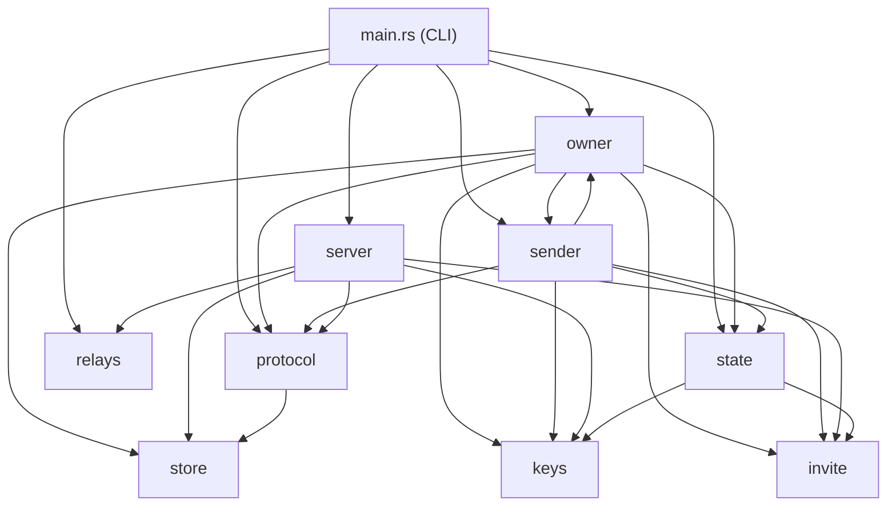

# Notes for agents working on this repository

Everything a coding agent needs before changing this code: where things are, the rules that must hold, how they are
checked, and how to build, release and test against Datum without breaking anything. Read the whole page before your
first change. If you only want to *use* an answering machine, you want [GUIDE.md](../GUIDE.md) or
[LEAVE.md](../LEAVE.md), not this.

## Read first

1. [README.md](../README.md): what it is.
2. [How it works](how-it-works.md): the parties, the two doors, invites, storage, with diagrams.
3. [Design](design.md): why each decision was made, and what was weighed and left out.
4. This page.
5. `src/lib.rs`: the module map.

## Layout

```
.
├── README.md            for people
├── GUIDE.md             for an owner's agent: deploy and run an answering machine
├── LEAVE.md             for a sender's agent: leave a message with an invite
├── AGENTS.md            points here; environment notes for agents on the author's machines
├── LICENSE              The Unlicense
├── Cargo.toml           dependencies, the [lints] table, the release profile
├── Cargo.lock           tracked; every build uses --locked
├── Containerfile        every build: toolchain, check, audit, build, binary, image
├── deny.toml            cargo-deny policy: advisories, licenses, sources, bans
├── clippy.toml          tests may unwrap
├── rustfmt.toml         120 columns
├── .containerignore     keeps target/, dist/, .git and keys out of the build context
├── src/
│   ├── lib.rs           module map, now_unix, random_hex, format_unix
│   ├── main.rs          the CLI: argument parsing, one endpoint per command, error shape and exit codes
│   ├── protocol.rs      ALPNs, request and reply types, call(), CallFailure and exit codes, message normalizing
│   ├── server.rs        am serve: config from the environment, the two doors, rate limiter
│   ├── store.rs         the server's SQLite mailbox
│   ├── invite.rs        signed invites: create, decode, check
│   ├── owner.rs         owner commands, manifest, fetch (save then ack), render
│   ├── sender.rs        leave, reply invites, saved invites
│   ├── state.rs         the state directory and owner.json
│   ├── keys.rs          keys as hex, files made with mode 600
│   └── relays.rs        Datum's relays, the address lookup, bind and bind_local
├── tests/
│   ├── round_trip.rs    real endpoints on loopback, through the commands' own functions
│   └── cli.rs           the am binary itself: output strings, exit codes
├── proptest-regressions/ seeds proptest saved; re-run before new cases (keep it committed)
├── deploy/datum/answering-machine.yaml   manifest template; am owner manifest fills it (server-env: same settings)
├── skills/answering-machine/SKILL.md      agent skill; am skill prints it with the image filled in
├── scripts/cargo.sh     cargo in the Containerfile's toolchain stage, against this checkout (fmt, quick tests)
└── docs/                how-it-works, design, commands, self-hosting, testing, dependencies, this page
```

`dist/` (built binaries, `image.digest`) and `target/` are ignored by git and by the build context.

### How the modules depend on each other



`owner` and `sender` call each other on purpose: `sender::leave` makes a reply invite with the owner key, and
`owner::reply` leaves a message as a sender.

### Strings other programs depend on

The guides, the skill and agents in the wild match on these. Change them only together with GUIDE.md, LEAVE.md,
SKILL.md and `tests/cli.rs`:

- `OWNER_ID=<64 hex>` (stdout of `owner init` and `owner id`)
- `SERVER_ENDPOINT_ID=<64 hex>` (stderr of `owner manifest`; stdout is only the YAML)
- `ENDPOINT_ID=<64 hex>` and `online: reachable through` (server logs, read with `datumctl compute logs`)
- `Answering machine <id>` and `Waiting on the server: N message(s)` (`owner status`)
- `Saved "NAME": an invite to …`, `Message #N left on …`, `Reply #N left on …`
- `No new messages.`, `No saved messages.`, `can reply: yes`
- `error: cannot <attempt>: <why>`, and exit codes 1, 2, 69 and 77 ([commands](commands.md))
- The labels `(verified, …)` and `(UNTRUSTED…)`, and `UNTRUSTED_NOTICE` in `owner.rs`

The docs URLs printed in invite messages and the skill come from the `docs_url!` macro in `owner.rs`, and GUIDE.md and
LEAVE.md must stay at the repository root for them. Moving the repository means changing that one line and rebuilding.

## Invariants

These must hold. Each has a test that fails without it, or says plainly that review is the only guard.

| Invariant | Enforced by |
| --- | --- |
| The owner door closes any peer whose handshake id is not in `OWNER_IDS`, before reading a request | `the_owner_door_closes_on_anyone_else` (mutation-checked) |
| A message is stored only with an invite an owner signed, that names this server, is unexpired and not revoked | `bad_invites_are_refused_and_nothing_is_stored`, `invite::tests::*` (mutation-checked) |
| A changed invite fails its signature | `changing_a_signed_invite_breaks_its_signature` |
| Sender-written text never passes for a verified line | `sender_text_cannot_pass_for_a_verified_line`, `no_sender_text_passes_for_a_verified_line` (property test; both renderer defences mutation-checked) |
| Untrusted input (invites, messages) is refused, never panics | `decoding_*_never_panics`, `normalizing_never_panics_and_keeps_only_text_and_data` |
| A full mailbox refuses new messages; it never drops old ones | `a_full_mailbox_refuses_new_messages_and_keeps_the_old_ones` |
| Rate limits hold per sender and per invite | `one_sender_is_limited_per_minute`, `fresh_keys_sharing_one_invite_are_limited_too` |
| A fetched message is saved before it is acked; duplicates are recognized only by server-assigned fields | `a_lost_ack_neither_loses_nor_duplicates`, `a_sender_reusing_a_message_id_loses_nothing` |
| Re-applying the manifest never loses a revocation or an owner | `re_applying_the_manifest_keeps_revocations_and_added_owners` (mutation-checked) |
| A manifest is never made from an extra owner's volume (it would mint a new server key) | `a_second_owners_volume_cannot_make_a_manifest` |
| Nothing unsafe can be pasted into the manifest | `the_manifest_is_complete_and_keeps_its_server_id_across_runs` |
| A panic in one request leaves the store usable | `a_panic_while_holding_the_store_does_not_break_it` (mutation-checked) |
| Exit codes tell unreachable (69) from refused (77) | `exit_codes_tell_an_unreachable_machine_from_a_refusal` (mutation-checked) |
| The server exposes nothing but its Iroh endpoint: no HTTP listener, NetworkService or load balancer | review only |
| Message text is never logged; logs carry ids, labels and sizes | review only |
| Keys and invites stay out of git, logs and chat; manifest output is only ever piped into `datumctl apply -f -` | review only |

"Mutation-checked" means the protection was removed on purpose and the test was seen to fail. Do that for any new
security test: a test that has never failed has not been shown to test anything.

## Security checklist for every change

Collected from the reviews of this code against the Rust CLI book, Canonical's Rust best practices, blessed.rs,
ANSSI's Secure Rust Guidelines, Mayhem's secure-programming notes and the Rust Secure Code WG's tools. Each line says
where it came from.

**Untrusted input**
- Everything a sender controls is untrusted: the message, `from`, the reply invite, the request bytes. Decide what it
  may contain, rebuild it from the fields you keep (`normalize_message`), and refuse the rest. (Mayhem: sanitize input)
- Sender text is shown on one line (`one_line`) or behind the `| ` margin, under `UNTRUSTED_NOTICE`. Never print it
  where it could look like a field. Extend `no_sender_text_passes_for_a_verified_line` if you add a field.
- Nothing parsed from the network may panic. New parsers get a property test like the existing ones. (ANSSI
  LANG-LIMIT-PANIC; proptest)
- Values pasted into YAML or shell go through an allow-list (`check_image_reference`, `check_resource_name`).

**Arithmetic, panics, errors**
- No plain arithmetic on values from outside (the command line, the network, a signed invite): cap them, then use
  `checked_*`. `--hours` once overflowed. (ANSSI LANG-ARITH)
- Release builds keep `overflow-checks = true` and `panic = "unwind"`; locks recover from poisoning. Don't switch to
  `abort`: one panicking request would take every unread message with it. (ANSSI LANG-LIMIT-PANIC; Mayhem: keep
  mitigations on)
- No `unwrap` outside tests (a compile error via `[lints]`). `expect` only with a message stating a startup fact.
  (Canonical, error and panic discipline)
- No `unsafe` anywhere: `#![forbid(unsafe_code)]` in both crate roots. (ANSSI LANG-UNSAFE)
- Errors: the reason reads as a plain clause, never starting with "cannot"; `main.rs` adds the one "cannot
  <attempt>:". Network failures carry a `CallFailure` so the exit code is right. (Canonical; Rust CLI book, exit codes)

**Secrets**
- Keys and saved invites are written with mode 600 (`keys::write_private`). Never print, log or echo them. Invites in
  examples are `am1.…`.
- The manifest holds the server's secret key: pipe it into `datumctl apply -f -`; never write it to a file or print it.
- Never put registry or cloud credentials on a build host.

**Output**
- Results to stdout, errors and logs to stderr. Colors only on a terminal. Stdin reads say what they want when stdin
  is a terminal, and stay quiet when piped. (Rust CLI book, output and communicating with humans and machines)

**Dependencies**
- A new dependency needs a row in [dependencies](dependencies.md): what it is for, its license, why it was chosen
  (blessed.rs where it covers the job). Its license must be in `deny.toml`'s allow-list; don't widen the list without
  saying why. (ANSSI LIBS-VETTING-DIRECT)
- `podman build --target audit .` must pass before an image is published. An ignored advisory needs a reason in
  `deny.toml` and the `cargo audit bin` line in the Containerfile. (ANSSI LIBS-AUDIT, LIBS-OUTDATED; cargo-deny,
  cargo-audit, cargo-outdated)
- The toolchain image is pinned (`rust:1.99.1-bookworm`), and so is the runtime base (`hi/static`, by digest). Moving
  either is a deliberate change. (ANSSI DENV-STABLE)
- The runtime image has no shell and runs as uid 65532. Anything `am` writes must be under `/state` or
  `/var/lib/answering-machine`, created in the build stage and copied in with `--chown`. Don't add a shell back for
  convenience; debug with logs, or run the binary from `--target binary` locally.

**Style** (people read this first; Canonical's guide and the sibling Datum demos)
- Comments say why, not what. Limits are named constants. A few plain lines beat a clever one.
- Name things instead of using tuples (`MailboxStats`, not `.0`). Three import groups: std, external, crate.
- Tests are named for the intent they protect, and check key strings rather than whole layouts or `--help`.

## Commands

The project uses rootless Podman, and Podman is all that has been tested. Docker or another compatible tool works the
same way: swap the command, and leave out Podman-only flags (`--http-proxy=false`). Keep `:z` on bind mounts on SELinux
hosts; Docker understands it too.

```sh
podman build --target check .            # rustfmt --check, clippy -D warnings, all tests. Must pass before committing.
podman build --target audit .            # cargo deny check, cargo outdated, cargo audit bin. Needs the network.
podman build -t ghcr.io/dlotterman/iroh-answering-machine:latest .   # the image
podman build --target binary -o dist .   # dist/am
scripts/cargo.sh fmt                     # rewrite formatting in the checkout
scripts/cargo.sh test --no-fail-fast     # quick test runs against the checkout
scripts/cargo.sh clippy --all-targets -- -D warnings
```

With Docker, use `docker build` the same way. The cache mounts and `-o` need BuildKit, the default since
Docker 23. `scripts/cargo.sh` calls `podman`; with
Docker, change the two commands in it, and leave out `--http-proxy=false`.

`scripts/cargo.sh` mounts the whole checkout; the Containerfile copies only what it names. When you add a file the
build reads (like `clippy.toml` once was), add it to the Containerfile too, or the check stage will see something
different from your local runs.

The build caches the cargo registry and target directory in cache mounts, so later builds take seconds to a couple of
minutes. A cold `check` or release build takes 5 to 7 minutes on a workstation. If you have a larger build host, sync
the tree there (`rsync -a --delete --exclude target --exclude dist --exclude .git`) and build with rootless podman only.
Bring images back with `podman save | podman load` and push from the workstation, so no credentials go to the build host.

## Releasing an image

1. `podman build --target check .` and `podman build --target audit .` pass.
2. Build the image, then smoke-test it through Datum's real relays (the loopback tests never touch them). Run a local
   server container from a fresh owner's manifest values, then exercise invite, leave with `--reply-invite auto`,
   inbox, reply, a refused owner (exit 77) and a stopped server (exit 69). Remove the test containers and volumes.
3. Push from the workstation: `podman push --digestfile dist/image.digest ghcr.io/dlotterman/iroh-answering-machine:latest`.
4. Replace the old digest everywhere it is pinned: 6 places in GUIDE.md, 2 in LEAVE.md and 2 in docs/self-hosting.md.
   `grep -c` all three files after.
5. Update [testing](testing.md): which image was smoke-tested, and whether it has run on Datum.
6. Commit the code, the digest and the docs together, so the guides never point at an image the code doesn't match.

## Deploying and testing on Datum

Deploys are outward-facing. Confirm the scope with your human first.

- Use a fresh `am-<random>` name, and check that `datumctl get` answers `(NotFound)` for the network, the secret and
  the workload before applying. The guide's loop does this and fails closed.
- Touch only resources you created. Other answering machines and other demos may share the project.
- Run `datumctl` from the container with `--http-proxy=false` before the image name, and `-i` (not `-t`) so stdin can
  be piped.
- A restart or a re-apply replaces the instance. Fetch messages first (`owner inbox`), or tell your human what will be
  lost.
- Tear down with the guide's "Clean up" section and check that each resource answers `(NotFound)`. Deleting the owner
  volume deletes the keys: the next deployment gets a new endpoint id, and old invites stop working.

### Testing the guides with fresh agents

The guides are tested by giving them to agents that have never seen this repository:
- Give each agent an empty working directory containing only the prompt, and point it at the guide's URL.
- Give each one its own state volume (`am-<agent>`), so parallel runs can't collide, and tell it not to install the
  skill into the user's real skill directory (save it inside the run directory instead).
- For Claude Code: `claude -p --model <model> --permission-mode bypassPermissions --strict-mcp-config` with
  `--disallowedTools "Bash(*<name you must not touch>*)" "Bash(*answering-machine:/state*)"` to protect resources and
  the user's own volume. Codex has no substring deny rule; say it in the prompt and read its transcript afterwards.
- Ask for an honest report: what it did, every check, anything unclear or wrong with exact error text, what it deleted.
- Afterwards, verify the cleanup yourself. Agents misread `datumctl` output now and then, and parallel runs can look
  like each other's leftovers.

Past runs and what they changed are in [testing](testing.md).

## Known gaps

- The current image has been smoke-tested through Datum's relays but not yet deployed on Datum; see [testing](testing.md).
- Untested: Docker (only podman), Gemini CLI, more than two owners, a real flood against the limits.
- Messages that wait on the server are lost when the instance is replaced. That is a design choice for the demo; see
  [design](design.md).
