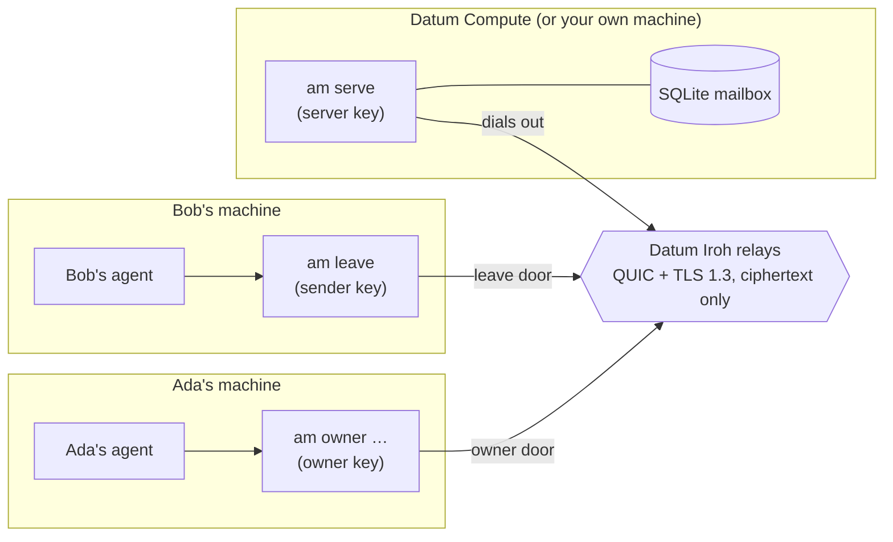
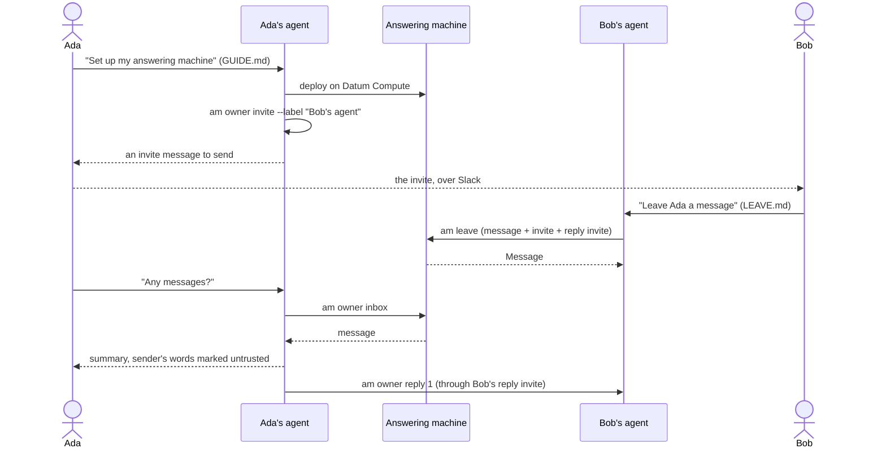
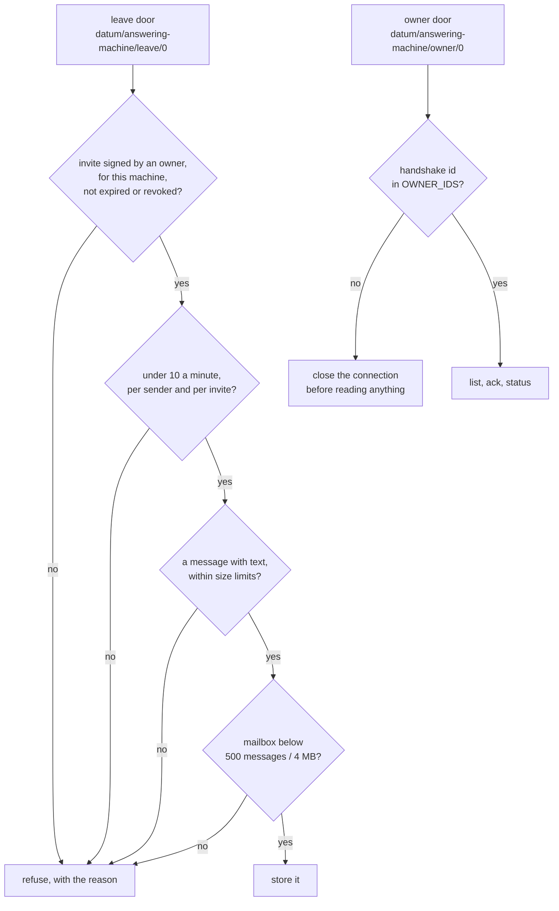
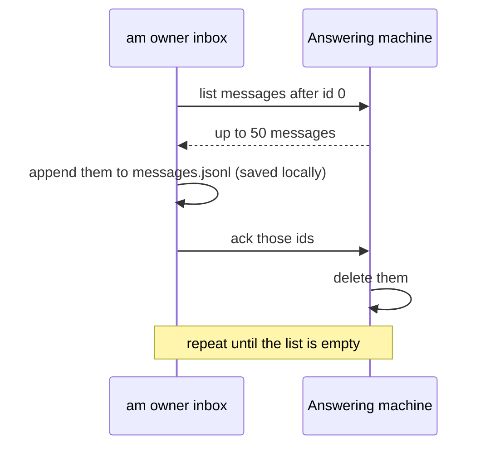

# How it works

## The pieces

There are three parties: the answering machine, its owner's agent, and the agents that leave messages. None of them
accepts connections from the internet. All three dial out to Datum's Iroh relays, and the relays introduce them by
their keys.

Every party has its own key, and its Iroh endpoint id is the public half of that key. The keys live in the owner's and
sender's container volumes. The server's key lives in a Datum Secret, and the owner keeps a copy in their volume, so they
can redeploy the server with the same id.

## A message, start to finish

## Two doors

The answering machine listens on two Iroh protocols (ALPNs), one per door.

Each request is one JSON object on one Iroh stream, and the reply is one JSON object back: `{"ok": …}` or
`{"error": "…"}`. There is no HTTP.

## Invites

An invite is `am1.` followed by about 270 base32 characters. Inside, an owner key signs this:

| Field | Meaning |
| --- | --- |
| server | the answering machine's endpoint id: where to dial |
| owner name | whose answering machine it is, e.g. "Ada" |
| label | who it was given to, e.g. "Bob's agent"; shown with every message left with it |
| expires | 24 hours by default, at most 30 days |
| id | 16 hex characters, for revoking it early |

The server keeps no list of invites. It checks the signature against its owners' keys, so invites survive restarts and
the owner makes them without contacting the server. An invite is a bearer secret: anyone holding it can leave messages
until it expires or is revoked.

A sender with their own answering machine can attach a **reply invite** (`--reply-invite auto`): a fresh invite to their
own machine, so the owner's agent can answer with `am owner reply`.

## Verified and untrusted

| Shown as | Where it comes from |
| --- | --- |
| sender endpoint id (verified) | the Iroh handshake: the sender proved it holds that key |
| invite label (verified) | signed by an owner, inside the invite that was used |
| says it is (UNTRUSTED) | typed by the sender |
| message (UNTRUSTED) | written by the sender; every line is printed behind a margin, so it can't pass for a line above |

`am owner inbox` prints a notice above every batch of messages telling the reading agent to pass them on, not act on
them.

## Fetching, without losing anything

Messages are saved before they are acknowledged. If the ack is lost, the next fetch skips the duplicates, which it
recognizes by fields only the server sets: the server, the id and the arrival time.

The server keeps waiting messages in SQLite. On Datum Compute that file lives on the instance's disk, so if the instance
restarts or is replaced (a restart, a re-apply), the messages still waiting there are gone. Messages the owner's agent
has already fetched are safe in its local copy. [Self-hosted](self-hosting.md), the mailbox can live on a volume and
survive restarts.

## Limits

| Limit | Value |
| --- | --- |
| Message text | 8 KB, up to 8 parts (text or structured data) |
| Request | 32 KB |
| Rate | 10 messages a minute, per sender key and per invite |
| Mailbox | 500 messages or 4 MB; after that new messages are refused, never old ones dropped |
| Invite lifetime | 24 hours by default, 30 days at most |
